# LinkMyMac Complete Feature Catalog & Ecosystem Analysis

> **Comprehensive Reverse-Engineering Analysis (REA) Reference**  
> *Target Applications:*  
> - **macOS / iPadOS Client:** LinkMyMac (App Store ID: `6755784154`, bundle: `com.kdg.linkmymac` / formerly `LinkMyDroid`)  
> - **Android Companion:** LinkMyMac (Play Store ID: `com.kdg.beam_android`, internal code: `beam`)  
> - **P2P Transfer Utility:** LinkMyDrop (`https://linkmymac.com/linkmydrop`)  
> *Developer:* Kevin Gnanih (KDG)  
> *Current Ecosystem Version:* 1.61  

---

## 1. Executive Summary & Product Architecture

LinkMyMac is a privacy-first, local-network ecosystem bridge designed to bring Apple Continuity-like integration between Android devices and macOS / iPadOS workstations without third-party cloud intermediaries.

```mermaid
flowchart LR
    subgraph Android["Android Device (Companion App)"]
        ALS["NotificationListenerService"]
        ACS["ClipboardManager"]
        AFS["File Storage & MediaStore"]
        AMC["MediaProjection / Scrcpy Daemon"]
        ACAM["Camera2 Virtual Source"]
        A_NET["mDNS Broadcaster + TLS / WS Daemon"]
    end

    subgraph Transport["Direct P2P Transport (Zero Cloud)"]
        WIFI["Local Wi-Fi (mDNS Bonjour / TLS)"]
        USB["USB (ADB Reverse / TCP Tunnel)"]
    end

    subgraph Mac["macOS Workstation (LinkMyMac)"]
        M_STATUS["NSStatusItem (Menu Bar Hub)"]
        M_NOTIF["UNUserNotificationCenter"]
        M_PASTE["NSPasteboard Sync"]
        M_DROP["NSDraggingDestination (File Drop)"]
        M_CAM["CMIO Virtual Camera Extension"]
        M_SCR["VideoToolbox H.264/H.265 Stream"]
    end

    Android <--> Transport <--> Mac
```

---

## 2. Exhaustive Feature Matrix

### Category A: Pairing, Discovery & Connection Lifecycle

| Feature | Description | Android Role | macOS Role | Connectivity Modes |
| :--- | :--- | :--- | :--- | :--- |
| **One-Time QR Pairing** | Mac displays a secure QR containing local IP, port, ephemeral TLS public key, and session secret. Android camera scans to exchange credentials. | Scans QR, parses JSON payload, stores Mac TLS fingerprint. | Generates cryptographic nonce, renders QR, listens for handshake. | Wi-Fi / Local Subnet |
| **Zero-Configuration Discovery** | mDNS / Bonjour advertising (`_linkmymac._tcp`) discovers paired devices without static IP configuration. | Broadcasts or resolves Bonjour TXT records. | Registers `NSNetService` listener and discovers paired endpoints. | Local Wi-Fi (mDNS) |
| **Instant Auto-Reconnect** | Automatically restores connection when phone joins same Wi-Fi, after phone restart, Mac wake-from-sleep, or toggle of network interface. | Foreground Service + NetworkCallback listens for Wi-Fi SSID match. | Background daemon maintains heartbeat pings (10s keepalive). | Local Wi-Fi |
| **USB Direct Mode** | Plug-and-play high-speed connection over USB cable bypassing Wi-Fi congestion or enterprise AP isolation. | Communicates over local loopback (`127.0.0.1`) forwarded via ADB reverse. | Detects USB device, spawns ADB forward/reverse socket tunnel. | USB Cable |
| **Dual-Mode Transition** | Seamlessly switches between USB and Wi-Fi without interrupting background sync (notifications, clipboard). | Manages transport priorities (USB preferred for latency, Wi-Fi for mobility). | Smoothly transitions active sockets. | USB & Wi-Fi |
| **Duo Mode (1 Phone, 2 Macs)** | Single Android phone connects simultaneously to two Macs (e.g., iMac + MacBook). Notifications and clipboard sync to both; exclusive features (mirroring) lock to one. | Maintains concurrent TLS sessions with multi-client state multiplexer. | Detects active session lock and coordinates feature ownership. | Local Wi-Fi |

---

### Category B: Notifications & Messaging

| Feature | Description | Android Role | macOS Role |
| :--- | :--- | :--- | :--- |
| **Native Notification Mirroring** | Mirrored phone notifications rendered as native macOS notification banners with app icon, sender, title, and body. | `NotificationListenerService` intercepts `StatusBarNotification`, extracts bundle data and app icon. | Dispatches `UNNotificationRequest` via `UserNotifications` framework. |
| **Grouped Conversations** | Notifications from chat apps (WhatsApp, Telegram, Signal, Slack) grouped by conversation thread. | Maps notification conversation key (`shortcutId` / `key`). | Uses `threadIdentifier` in macOS notifications to group previews. |
| **Actionable Quick Replies** | Inline text reply directly from macOS banner without touching phone. | Injects input into `Notification.Action` with `RemoteInput`. | Handles notification action input text and streams back payload. |
| **Custom Notification Actions** | Secondary actions (Mark as Read, Archive, Mute, Dismiss) forwarded to phone. | Triggers original `PendingIntent` associated with the action. | Renders interactive notification buttons. |
| **App Filtering & Mute** | Selective blacklisting/whitelisting of apps to suppress noisy notifications. | Filter engine on device before network serialization. | Preferences panel to toggle mirroring per application. |
| **Messages (SMS/MMS/RCS)** | Reading and responding to SMS/MMS/RCS threads directly from macOS dashboard. | Queries `Telephony.Sms` & `Telephony.Mms` or hooks Google Messages Web. | Native side-by-side chat view with contact list and conversation thread. |
| **Incoming Call Alerting & Controls** | Incoming calls pop up on Mac: Answer, Decline, Silence, Send SMS. *(Cellular audio remains on phone).* | `TelecomManager` / `PhoneStateListener` intercepts call state and exposes call actions. | Displays Call banner with native audio ringtone and control buttons. |

---

### Category C: File Transfer & Storage Management

| Feature | Description | Android Role | macOS Role |
| :--- | :--- | :--- | :--- |
| **Bidirectional File Transfers** | High-speed local transfer of files, folders, and documents between Mac and Android. | Dedicated HTTP/TCP streaming server/client with scoped storage access. | Native file sender/receiver with multi-threaded streaming chunks. |
| **Menu Bar Drag & Drop Target** | Dragging any file or folder onto the macOS Menu Bar icon immediately triggers transfer to phone. | Receives transfer prompt or saves directly to `Downloads/LinkMyMac`. | `NSStatusItem` configured as `NSDraggingDestination`. |
| **Live Transfer Monitor** | Real-time progress bar, transfer speed (MB/s), bytes transferred, estimated time remaining. | Progress tracking callbacks over socket. | Native HUD / Popover progress indicator with Cancel button. |
| **Cancel & Interruption Recovery** | Graceful cancellation and automatic resume of interrupted transfers upon network drop. | Partial file chunk verification with `.part` temp file handling. | Range requests / chunk offset resume protocol. |
| **Transfer History & Finder Reveal** | Recent transfers log with one-click "Reveal in Finder" button. | Maintains transfer SQLite database. | Integrates with `NSWorkspace.shared.activateFileViewerSelecting()`. |
| **Photo Library Explorer** | Browse Android gallery on Mac in a native grid, with multi-select, Quick Look (Spacebar), and drag-to-Finder. | Indexing MediaStore photos/videos and serving thumbnails/full-res on demand. | Native SwiftUI / AppKit photo grid with `QLPreviewController` Quick Look. |
| **macOS Photos Integration** | One-click import of Android photos and videos directly into the Apple Photos app. | Delivers full uncompressed originals. | Bridges to `PhotoKit` (`PHPhotoLibrary`) to import assets. |

---

### Category D: Screen Mirroring & App Streaming

| Feature | Description | Android Role | macOS Role |
| :--- | :--- | :--- | :--- |
| **Standard Mirroring** | One-tap screen sharing with low setup requirement. | Captures screen via `MediaProjection` API and encodes using `MediaCodec` (H.264). | Decodes video using `VideoToolbox` / `AVPlayerLayer` in a resizable window. |
| **Advanced Mirroring (Scrcpy Engine)** | High-fps, ultra-low-latency display, full keyboard/mouse control, and device audio streaming. | Runs lightweight headless server injected via ADB (`app_process`). | Sends HID mouse/keyboard events over socket, decodes raw H.264 stream. |
| **Screen-Off Mirroring** | Mirror and control the phone while keeping the physical phone screen turned off to save battery and maintain privacy. | Turns off phone backlight via `SurfaceControl` or ADB `setDisplayPower`. | Controls phone freely while phone screen remains dark. |
| **Isolated App Windows** | Run individual Android apps in separate macOS desktop windows rather than mirroring the whole screen. | Launches target activity in a virtual display or secondary task stack. | Maps each virtual display to an independent AppKit window. |
| **Device Audio Streaming** | Android device media audio (YouTube, Spotify, games) streamed to Mac speakers. | Captured via `AudioPlaybackCapture` (Android 10+) or internal audio capture. | Decoded and played via `CoreAudio` / `AVAudioEngine`. |
| **Cast (Beta)** | Send media from Android Share Sheet or Quick Settings tile straight to Mac display. | Implements system Share Target and Quick Settings Tile. | Renders receiver view for photos, videos, and web links. |

---

### Category E: Clipboard & Hardware Utilities

| Feature | Description | Android Role | macOS Role |
| :--- | :--- | :--- | :--- |
| **Bidirectional Clipboard Sync** | Copy text or URLs on Android, immediately paste on Mac (and vice versa). | Listens via `ClipboardManager.OnPrimaryClipChangedListener`. | Monitors `NSPasteboard` change count and updates system pasteboard. |
| **Clipboard Image Sync** | Synchronizes copied screenshots and images across devices. | Encodes image clip data to PNG/JPEG stream. | Writes image data to `NSPasteboard` with `public.png` / `public.tiff`. |
| **Clipboard History Search** | Searchable history of recent clipboard entries from the Menu Bar. | Maintains local cache of recent clips. | Popover menu with search bar and one-click re-copy. |
| **Phone as Mac Webcam** | High-definition wireless/USB webcam using Android rear or front camera with exposure and autofocus controls. | Streams Camera2 raw frames encoded in H.264. | Registered as a CoreMediaIO DAL Plugin or Camera Extension (`CMIOExtension`). |
| **Phone Microphone Streaming** | Stream phone microphone to Mac as a virtual input audio device. | Streams PCM audio over TCP socket. | Feeds virtual CoreAudio device driver. |
| **Menu Bar Control Centre** | Lightweight status bar hub showing phone battery percentage, Wi-Fi/USB status, transfer widget, and quick toggles. | Reports battery level, charging status, network stats over telemetry heartbeat. | `NSStatusItem` displaying real-time icon status and rich context menu. |

---

### Category F: Privacy & Security Guarantees

| Feature | Description | Implementation Mechanism |
| :--- | :--- | :--- |
| **Zero Cloud Relay** | No server intermediary, no AWS/Firebase relay, zero telemetry data sent to third parties. | 100% peer-to-peer over local subnet (`192.168.x.x` / `10.x.x.x`) or USB loopback (`127.0.0.1`). |
| **No Account Requirement** | Instant setup without email, password, Google Sign-In, or Apple ID association. | Cryptographic keypairs generated locally on device during first launch. |
| **Encrypted Transit** | Local communication secured with mutual TLS (mTLS) or AES-256-GCM / ChaCha20-Poly1305. | Ephemeral certificate pinned during QR pairing handshake. |
| **Privacy Ledger & Diagnostics** | Transparent local logging of data transfers without remote reporting. | User-accessible local diagnostic log. |

---

## 3. Summary of LinkMyMac Value Proposition

LinkMyMac solves the single biggest friction point for Android users who use macOS workstations:
- Apple purposefully restricts AirDrop, Continuity, Universal Clipboard, and iMessage to Apple hardware.
- Google / Microsoft Phone Link only supports Windows.
- LinkMyMac bridges this gap seamlessly, privately, and locally with native macOS design language (AppKit / SwiftUI).
