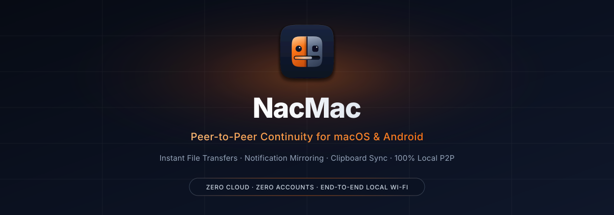
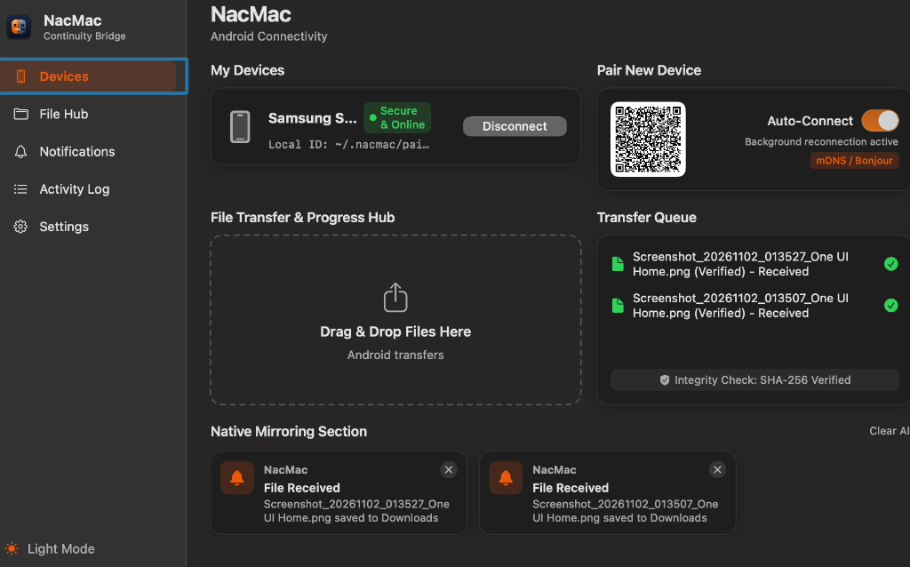
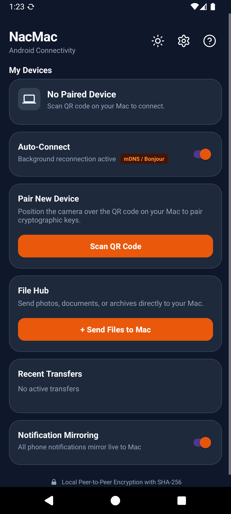
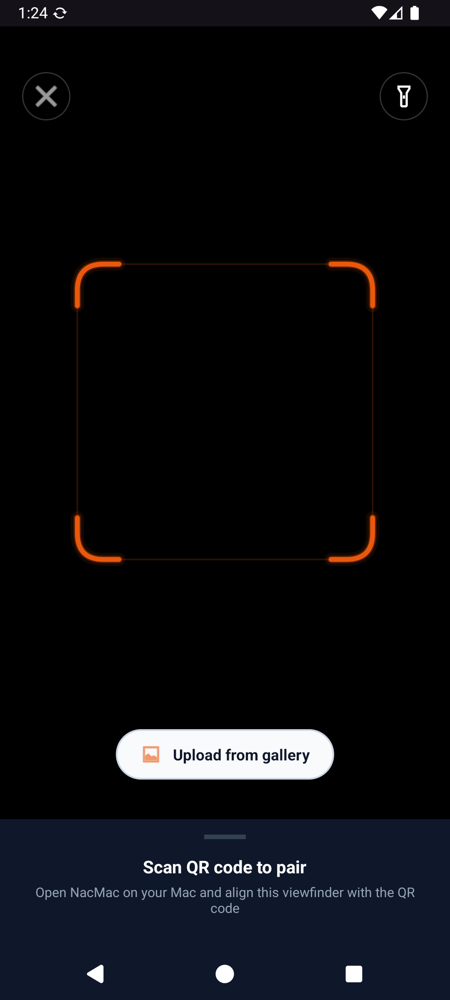

<p align="center">
  
</p>

<p align="center">
  <a href="LICENSE"></a>
  
  
  
  
  
  
</p>

<h3 align="center">
  Instant P2P file transfers, real-time notification mirroring, and clipboard sync between Android and Mac.<br>
  Zero cloud servers. Zero account logins. 100% private on your local Wi-Fi.
</h3>

<p align="center">
  <a href="#download--quick-start"><b>Download v1.0.0</b></a> ·
  <a href="#see-it-work"><b>See It Work</b></a> ·
  <a href="#features"><b>Features</b></a> ·
  <a href="#the-philosophy"><b>The Philosophy</b></a> ·
  <a href="#architecture--wire-protocol"><b>Architecture</b></a> ·
  <a href="#building-from-source"><b>Build from Source</b></a> ·
  <a href="docs/SPECIFICATION.md"><b>Protocol Spec</b></a>
</p>

---

## Download & Quick Start

### macOS Workstation (macOS 13.0+)
1. Download **`NacMac-v1.0.0.dmg`** from the [Releases](https://github.com/AyushB2262/NacMac/releases) page.
2. Open the disk image and drag **NacMac.app** into `/Applications`.
3. Launch NacMac. It will appear in your Menu Bar with an amber indicator dot.

> [!NOTE]
> **First-time launch (macOS Gatekeeper):** Because open-source community builds are not notarized through an Apple Developer subscription, macOS may prompt an unidentified developer warning. You can clear the quarantine attribute with a single command in Terminal:
> ```bash
> xattr -dr com.apple.quarantine /Applications/NacMac.app
> ```

---

### Android Companion (Android 8.0+)
1. Download **`NacMac-v1.0.0.apk`** from the [Releases](https://github.com/AyushB2262/NacMac/releases) page.
2. Install the APK on your phone (enable *"Install unknown apps"* if prompted).
3. Open NacMac and grant the necessary permissions:
   - **Notification Access:** Allows NacMac to mirror alerts to your Mac.
   - **Camera:** Used strictly to scan the pairing QR code.

---

### Pair in 5 Seconds
1. Click the **NacMac** icon in your macOS Menu Bar or open the Dashboard to display the dynamic QR code.
2. In the Android app, tap **Scan QR Code**.
3. Point your camera at your Mac screen. The devices will handshake and show **Secure & Online** immediately.

---

## See It Work

### 1. macOS Workstation Dashboard & Menu Bar Hub
A minimal, dark-mode native dashboard providing instant visibility into paired devices, real-time file transfer queues with SHA-256 verification badges, and mirrored notifications:

<p align="center">
  
</p>

- **Menu Bar Status Item:** Resides silently in your Mac's menu bar with live connection dots, QR popover, and drag-and-drop file target.
- **File Transfer & Progress Hub:** Drag and drop files from Finder directly onto the hub or menu bar icon to send them to Android.
- **Cryptographic Verification:** Every completed transfer undergoes automated SHA-256 validation before reaching your `~/Downloads/NacMac` folder.

---

### 2. Android Companion & One-Tap Dynamic Pairing
Built with Android Material 3 and modern dark slate styling, offering single-tap camera pairing, persistent background connection management, and live transfer history:

<table align="center" width="100%">
  <tr>
    <td align="center" width="50%">
      <br />
      <sub><b>Companion App:</b> Status, quick send, and verified transfer history</sub>
    </td>
    <td align="center" width="50%">
      <br />
      <sub><b>CameraX Scanner:</b> 5-second dynamic QR pairing with auto-focus</sub>
    </td>
  </tr>
</table>

---

## Features

- [x] **High-Speed P2P File Transfers:** Stream files of any size over your local Wi-Fi. Files are chunked into 256 KB binary payloads with live speed metrics (MB/s), visual progress, and cancellation support.
- [x] **Cryptographic SHA-256 Verification:** Source computes the SHA-256 digest during transmission; receiver validates the hash upon completion to guarantee zero corrupted bytes.
- [x] **Real-Time Notification Mirroring:** Intercepts notifications on Android (including `MessagingStyle`, `BigTextStyle`, and app icons) and renders them as native macOS system notification banners.
- [x] **Bidirectional Dismissal:** Dismissing a mirrored notification on macOS syncs back to Android immediately.
- [x] **Zero-Config mDNS Discovery:** macOS broadcasts an mDNS service (`_nacmac._tcp.local`) on port 52840. The Android companion automatically discovers and pairs without typing IP addresses.
- [x] **Background Auto-Reconnection:** Android's low-power foreground service automatically re-establishes connection whenever your phone wakes or re-joins your home network.
- [x] **Universal Clipboard Sync:** Automatically synchronizes clipboard text between Mac and Android with debounced change listeners.
- [x] **Strictly Local & Offline:** No internet connection required. Operates seamlessly on local home Wi-Fi, office networks, or mobile Wi-Fi hotspots.
- [x] **Adaptive Dark and Light Interface:** High-contrast design system featuring Deep Slate (`#0F172A`), Ice White (`#F8FAFC`), and warm Amber accents (`#F97316`).

---

## The Philosophy

Apple built AirDrop, Universal Clipboard, and Notification Mirroring to keep Mac users locked into the iPhone ecosystem. Windows built Link to Windows for Android users.

**If you love macOS for work but carry an Android phone in your pocket, you have been left behind.**

Until now, the only choices have been sluggish Bluetooth transfers, proprietary cloud-relay tools that harvest metadata, or browser web-uploaders that route your private camera photos through third-party servers.

**NacMac is the native peer-to-peer bridge built for privacy, speed, and simplicity.** It is guided by four principles:

1. **100% Local-First:** No accounts, no subscriptions, no cloud relays, no tracking. Communication stays strictly on your local Wi-Fi via high-throughput TCP sockets (`port 52840`).
2. **Zero-Configuration Discovery:** Pair once in five seconds with an ephemeral dynamic QR code. After that, Bonjour / mDNS (`_nacmac._tcp.local`) silently re-establishes connections whenever you sit down at your desk.
3. **High-Throughput Streaming:** 256 KB framed chunked streaming with live speed calculation, mid-stream cancellation, and cryptographic SHA-256 integrity verification.
4. **Native Ergonomics:** Crafted native from the ground up — Swift 6, AppKit, and SwiftUI on macOS; Kotlin, Jetpack Compose, and Material 3 on Android. No Electron, no browser engines, no memory bloat.

---

## Comparison: Why NacMac?

| Capability | NacMac | AirDroid / Cloud Apps | Quick Share (Windows) | Bluetooth Obex |
| :--- | :---: | :---: | :---: | :---: |
| **Data Leaves Local Network** | **Never (0% Cloud)** | Yes (Cloud servers) | Varies | No |
| **Account / Sign-In Required** | **None** | Mandatory | Google/Samsung | No |
| **macOS Native App** | **Swift 6 & SwiftUI** | Web / Electron | Not Available | Native system |
| **Android Native App** | **Kotlin & Material 3** | Java / Mixed | Samsung / Google only | Native |
| **Transfer Speed** | **Wi-Fi LAN Speed (50–100+ MB/s)** | Capped by Internet / Tier | LAN speed | ~200 KB/s (Painful) |
| **Integrity Verification** | **SHA-256 Cryptographic Hash** | Varies | Proprietary | Checksum only |
| **Notification Mirroring** | **Native macOS Banners** | Web Popups | Windows only | Not Available |
| **Open Source** | **MIT Licensed** | Proprietary | Proprietary | Open standard |

---

## Architecture & Wire Protocol

Communication occurs directly between the macOS daemon and Android companion across a persistent TCP connection on **port 52840**.

```mermaid
flowchart LR
    subgraph Android["Android Companion"]
        NLS["NotificationListenerService"]
        STORE["DeviceStore & MediaStore"]
        BG["NacMacBackgroundService"]
        A_SOCK["TCP Client + mDNS NsdManager"]
    end

    subgraph LAN["Local Subnet (Zero Cloud)"]
        P2P["Direct TCP Framing (Port 52840)"]
        MDNS["Bonjour mDNS (_nacmac._tcp.local)"]
    end

    subgraph Mac["macOS Workstation"]
        SRV["NetworkServer (NWListener)"]
        DASH["SwiftUI Dashboard"]
        NOTIF["UNUserNotificationCenter"]
        STATUS["NSStatusItem Hub"]
    end

    Android <--> LAN <--> Mac
```



### Protocol Framing
Every transmission is framed with a 4-byte big-endian unsigned length prefix, followed by a UTF-8 JSON packet:

```
+-----------------------------------+-----------------------------------+
| Length (4 Bytes, Big-Endian UInt32)| Payload JSON (UTF-8 Encoded String)|
+-----------------------------------+-----------------------------------+
```

| Packet Type | Description |
| :--- | :--- |
| `PAIR_REQUEST` | Android client sends `androidId`, `deviceName`, and cryptographic `authSecret`. |
| `PAIR_RESPONSE` | macOS validates token, binds trusted session, and returns workstation identity. |
| `HEARTBEAT_PING` / `_PONG` | 10-second periodic keep-alive maintaining low socket latency. |
| `FILE_START` | Initializes transfer with filename, file size, transfer ID, and expected SHA-256. |
| `FILE_CHUNK` | Streams 256 KB binary chunks Base64-encoded with byte offsets. |
| `FILE_END` | Signals stream completion; triggers recipient SHA-256 integrity validation. |
| `FILE_CANCEL` | Aborts active transfer and removes partial `.part` temporary files. |
| `NOTIFICATION` | Streams Android notification payload with title, body, and compressed app icon. |
| `NOTIFICATION_DISMISSED` | Synchronizes notification dismissal from macOS back to Android. |

> For the comprehensive protocol specification, state machine diagrams, and packet structures, refer to **[docs/SPECIFICATION.md](docs/SPECIFICATION.md)**.

---

## Building from Source

### Building macOS Application
**Prerequisites:** macOS 13.0+, Xcode Command Line Tools (`xcode-select --install`), Swift 6.0+.

```bash
cd macos

# Build the release bundle (produces NacMac.app)
./package_app.sh

# (Optional) Generate the distributable disk image (.dmg)
./package_dmg.sh
```

To run directly from Xcode or SwiftPM:
```bash
swift run NacMac
```

---

### Building Android Companion
**Prerequisites:** Android SDK (API 34), JDK 17+.

```bash
cd android

# Build debug APK
./gradlew assembleDebug

# Build release APK
./gradlew assembleRelease

# Install directly to a USB-connected phone or emulator
adb install -r app/build/outputs/apk/debug/app-debug.apk
```

---

## Testing & Verification

NacMac includes a headless end-to-end integration and protocol verification test suite. It validates TCP handshake mechanics, Bonjour discovery, heartbeat keep-alive, chunked file transfer with SHA-256 hashing, and notification mirroring in an isolated sandbox without altering existing paired credentials:

```bash
python3 tests/test_e2e_continuity.py
```

Expected output:
```
[PASS] Server port 52840 active & reachable
[PASS] Bonjour mDNS publication detected (_nacmac._tcp)
[PASS] Cryptographic QR pairing handshake verified
[PASS] Heartbeat PING / PONG keepalive active
[PASS] Notification packet dispatch & banner handling
[PASS] Chunked 256KB file transfer & SHA-256 integrity match
All 6 continuity test cases passed (100%).
```

---

## Keyboard Shortcuts (macOS)

NacMac follows native macOS application conventions:

| Shortcut | Action |
| :--- | :--- |
| <kbd>⌘</kbd> + <kbd>O</kbd> | Open File Picker to send files to Android |
| <kbd>⌘</kbd> + <kbd>,</kbd> | Open Settings |
| <kbd>⌘</kbd> + <kbd>W</kbd> | Close Dashboard Window (app continues in Menu Bar) |
| <kbd>⌘</kbd> + <kbd>Q</kbd> | Quit NacMac |

---

## Security & Privacy by Design

- **Zero Phoning Home:** No telemetry, no crash reporting SDKs, no external network requests.
- **Strictly LAN-Bound:** The TCP listener binds exclusively to local network interfaces. It rejects incoming connections lacking matching dynamic authentication secrets.
- **In-Memory & Encrypted Credentials:** Pairing keys are stored in secure local preferences (`EncryptedSharedPreferences` on Android, local application sandbox on macOS).
- **Temporary File Hygiene:** Incomplete file streams are written to `.part` files and purged immediately if canceled or if hash validation fails.

---

## Contributing

Contributions are welcome. Whether reporting issues, refining documentation, or expanding continuity features:

1. Fork the repository.
2. Create a feature branch: `git checkout -b feature/awesome-feature`
3. Commit your changes: `git commit -m "feat: add awesome feature"`
4. Push to your branch: `git push origin feature/awesome-feature`
5. Open a Pull Request.

---

## License

Distributed under the **MIT License**. See [LICENSE](LICENSE) for full details.
