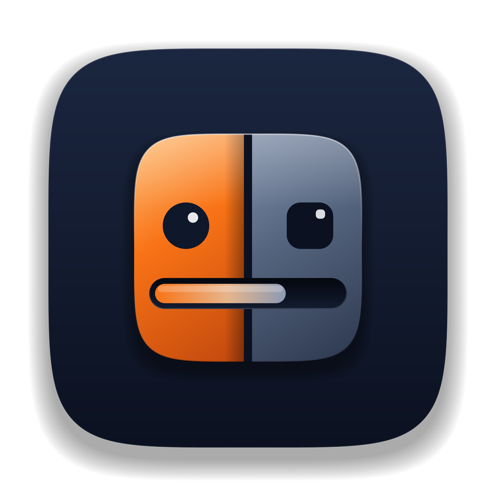

<p align="center">
  
</p>

# NacMac 🍏🤖
> **Privacy-first, peer-to-peer Continuity bridge between Android and macOS.**  
> Zero cloud servers. Zero data collection. End-to-end local network synergy.

[](macos/)
[-3DDC84?logo=android&logoColor=white)](android/)
[](macos/)
[](android/)
[](LICENSE)

---

## ✨ Features

- ⚡ **Zero-Config P2P Pairing:** Scan a dynamic QR code on your Mac screen from the Android app to pair instantly over your local Wi-Fi.
- 🔄 **Silent Auto-Reconnect:** Automatic background discovery and re-connection when returning home, waking from sleep, or switching Wi-Fi networks.
- 📁 **High-Speed Chunked File Transfer:** Drag and drop files directly onto the macOS Menu Bar icon or send from Android. Streamed via 256 KB chunks encoded as Base64 in JSON envelopes with live transfer speed calculation and mid-stream cancellation support.
- 🔔 **Real-Time Notification Mirroring:** Android notifications appear instantly as native macOS notification banners with seamless dismissal sync.
- 🛡️ **100% Local & Private:** All communication occurs strictly over local TCP sockets (`port 52840`) on your private LAN. No cloud intermediary, no analytics, no external telemetry.
- 🎨 **Adaptive "Preem" UI:** High-contrast, clean UI supporting native dark mode (Deep Slate `#0F172A`) and light mode with warm amber accents (`#EA580C`).

---

## 🏗️ Architecture & Project Structure

```
NacMac/
├── macos/                                # Native macOS Application (Swift 6 / AppKit / SwiftUI)
│   ├── Package.swift                     # Swift Package Manager manifest
│   ├── package_app.sh                    # Automated release build and bundling script
│   ├── package_dmg.sh                    # DMG disk image creation script
│   └── Sources/NacMac/
│       ├── NacMac.swift                  # App entry point & NSApplicationDelegate
│       ├── AppMenuController.swift       # Standard macOS Menu Bar (About, Quit Cmd+Q)
│       ├── DashboardWindowController.swift# NSWindowController hosting Dashboard
│       ├── DashboardView.swift           # Native SwiftUI Dashboard (Device status, Transfers)
│       ├── MenuBarController.swift       # Status bar item, QR popover & drag-drop target
│       ├── NetworkServer.swift           # Bonjour mDNS advertiser & framed TCP socket server
│       ├── PairingManager.swift          # Cryptographic key exchange & trusted device store
│       ├── NotificationManager.swift     # UNUserNotificationCenter native banner dispatcher
│       ├── FileTransferManager.swift     # Streaming chunked file receiver/sender with cancel
│       └── Models.swift                  # Framing envelopes & wire protocol data models
│
├── android/                              # Native Android Companion (Kotlin / Material 3)
│   ├── app/src/main/
│   │   ├── AndroidManifest.xml           # Foreground service & permissions configuration
│   │   ├── java/com/nactore/nacmac/
│   │   │   ├── ui/                       # MainActivity, QRScannerActivity, Viewfinder
│   │   │   ├── service/                  # NacMacBackgroundService, NotificationListener
│   │   │   ├── network/                  # TCP ConnectionManager, DiscoveryClient
│   │   │   ├── transfer/                 # Dual-direction FileTransferWorker
│   │   │   ├── data/                     # Encrypted/persisted DeviceStore
│   │   │   └── model/                    # Wire protocol packet structures
│   │   └── res/                          # Vector drawables, themes, and layouts
│   └── build.gradle.kts                  # Gradle build system
│
└── tests/
    └── test_e2e_continuity.py            # Automated end-to-end integration & protocol test suite
```

---

## 🚀 Getting Started

### Prerequisites

- **macOS:** macOS Ventura (13.0) or newer, Xcode Command Line Tools (`xcode-select --install`), Swift 6.0+.
- **Android:** Android 8.0+ (Oreo, API 26+), Android SDK, JDK 17.

### Building & Running macOS Client

```bash
cd macos

# Build release bundle (creates NacMac.app)
./package_app.sh

# Launch application
open NacMac.app
```

The app will appear in your macOS Menu Bar. Click the icon to view your pairing QR code or drag files directly onto the menu bar icon to send to Android.

### Building Android Companion

```bash
cd android

# Build debug APK
./gradlew assembleDebug

# Install to connected device via ADB
adb install -r app/build/outputs/apk/debug/app-debug.apk
```

---

## 🧪 Testing & Verification

NacMac includes an automated, headless end-to-end verification suite testing pairing handshakes, heartbeat ping/pong, notification dispatch, chunked file transfer with SHA-256 validation, and auto-reconnection (non-destructively preserving existing user configuration):

```bash
python3 tests/test_e2e_continuity.py
```

---

## 🔒 Security & Privacy

1. **No External Infrastructure:** NacMac does not phone home, does not require an account, and does not relay data through third-party servers.
2. **Ephemeral Handshake:** During pairing, secrets are exchanged locally via an ephemeral dynamic token displayed as a QR code.
3. **Local Socket Framing & Session Authorization:** Packets are framed with a 4-byte big-endian length prefix followed by UTF-8 JSON envelopes. The server strictly binds authorization to authenticated connections, rejecting any unauthenticated file transfers or notification injections.

---

## 📄 License

Distributed under the MIT License. See [LICENSE](LICENSE) for more information.
