# NacMac Technical Specification & Architecture

NacMac is a privacy-first, local-network peer-to-peer continuity system connecting Android devices with macOS workstations without third-party cloud servers or external telemetry.

---

## 1. System Architecture

```mermaid
flowchart LR
    subgraph Android["Android Companion App"]
        NLS["NotificationListenerService"]
        AFS["File Storage & MediaStore"]
        BG["NacMacBackgroundService"]
        A_NET["mDNS Client + Framing TCP Socket"]
    end

    subgraph Transport["Local Peer-to-Peer Transport (Zero Cloud)"]
        WIFI["Private Wi-Fi (mDNS Bonjour / TCP)"]
        P2P["Direct TCP Framing (Port 52840)"]
    end

    subgraph Mac["macOS Workstation Application"]
        M_STATUS["NSStatusItem (Menu Bar Hub)"]
        M_NOTIF["UNUserNotificationCenter"]
        M_DASH["SwiftUI Dashboard & Settings"]
        M_DROP["NSDraggingDestination (File Drop)"]
        M_NET["Bonjour Publisher + NWListener Server"]
    end

    Android <--> Transport <--> Mac
```



---

## 2. Core Functional Specifications

### A. Pairing & Discovery Lifecycle
- **Dynamic QR Pairing:** macOS generates a cryptographically random session secret and presents an interactive QR code containing primary IP addresses, port 52840, and the auth secret. Android's CameraX scanner captures the payload and performs an instant handshake.
- **Zero-Configuration mDNS:** macOS advertises a Bonjour service of type `_nacmac._tcp.` on port 52840. Android's `DiscoveryClient` uses `NsdManager` to locate workstations on the same local subnet without requiring static IP configuration.
- **Background Auto-Reconnection:** Android's persistent foreground service (`NacMacBackgroundService`) listens to network availability callbacks and automatically reconnects to paired workstations with exponential backoff and heartbeat verification.

### B. High-Speed File Transfer
- **Framed Chunk Streaming:** Files are broken into 256 KB binary chunks, Base64-encoded inside JSON transport envelopes, and streamed across the TCP socket.
- **Integrity Verification:** Cryptographic SHA-256 hashes are computed on the source and verified on the target before moving temporary `.part` files to the final destination directory (`Downloads/NacMac`).
- **Interactive Queue & History:** Both macOS and Android maintain a synchronized visual queue displaying active progress, transfer speed, file size, directional badges (Sent / Received), and SHA-256 integrity badges.

### C. Real-Time Notification Mirroring
- **Notification Interception:** Android's `NacMacNotificationListener` intercepts system and third-party notifications (including `Notification.MessagingStyle`, `BigText`, and `InboxStyle`), packages the title, body text, timestamp, and compressed 96×96 app icon, and streams them to macOS.
- **Native macOS Banners:** Forwarded notifications are dispatched via `UNUserNotificationCenter` as native macOS system notification banners and recorded in the macOS Dashboard.
- **Bidirectional Dismissal:** Dismissing a mirrored notification on macOS forwards a `NOTIFICATION_DISMISSED` envelope to Android to sync state.

---

## 3. Wire Protocol Reference

All communication travels over framed TCP packets consisting of a 4-byte big-endian length header followed by a JSON payload envelope:

```
+-----------------------------------+-----------------------------------+
| Length (4 Bytes, Big-Endian UInt32)| Payload JSON (UTF-8 Encoded String)|
+-----------------------------------+-----------------------------------+
```

### Message Types
| Type | Description |
| :--- | :--- |
| `PAIR_REQUEST` | Android client auth handshake containing `androidId`, `deviceName`, and `authSecret`. |
| `PAIR_RESPONSE` | macOS server authentication confirmation (`success: Bool`, `macName: String`, `macId: String`). |
| `HEARTBEAT_PING` / `_PONG` | Periodic 10-second keepalive signal maintaining active NAT/socket states. |
| `NOTIFICATION` | Forwarded notification envelope containing title, body, app name, icon, actions, and reply capability. |
| `NOTIFICATION_DISMISSED` | Notification dismissal sync payload (`id`, `deviceId`). |
| `NOTIFICATION_ACTION` | Interactive action button triggers and in-line remote text replies (`notificationKey`, `actionIndex`, `replyText`). |
| `CLIPBOARD_SYNC` | Universal clipboard synchronization across connected devices (`text`, `timestamp`, `sourceDeviceId`, `hash`). |
| `SMS_CONVERSATIONS_REQUEST` | macOS request querying SMS thread list from Android companion (`limit`). |
| `SMS_CONVERSATIONS_RESPONSE` | Android response returning thread list (`threads: [SMSThreadItem]`, `deviceId`). |
| `SMS_MESSAGES_REQUEST` | macOS request for message history in a specific thread (`threadId`, `limit`). |
| `SMS_MESSAGES_RESPONSE` | Android response returning historical messages (`threadId`, `messages`, `deviceId`). |
| `SMS_SEND` | Outbound SMS dispatch command from macOS desktop (`recipient`, `message`, `threadId`). |
| `SMS_SEND_STATUS` | Android dispatch result confirmation (`success: Bool`, `message: String`, `threadId`). |
| `FILE_START` | File metadata initialization packet (`transferId`, `filename`, `size`, `sha256`). |
| `FILE_CHUNK` | Binary chunk payload (`transferId`, `offset`, `length`, `dataBase64`). |
| `FILE_END` | Transfer finalization marker triggering SHA-256 verification. |
| `FILE_CANCEL` | Mid-stream cancellation trigger for immediate `.part` cleanup. |
| `FILE_ACK` | Positive receipt confirmation for transfer coordination. |
| `ERROR` | Diagnostic error and exception messaging. |
